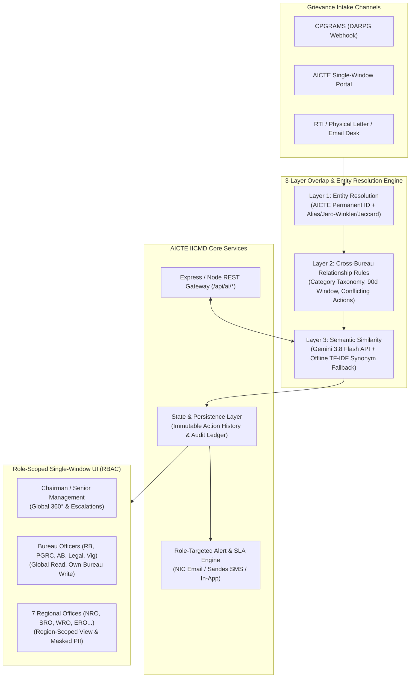

# AICTE Integrated Institution Complaint Monitoring & Status Dashboard (IICMD)

A single-window, real-time complaint monitoring, cross-bureau overlap detection, and institutional 360° governance platform built for the **All India Council for Technical Education (AICTE)**, Ministry of Education, Government of India.

---

## 1. Problem Context & Solution Mapping

AICTE receives complaints regarding technical institutions from students, faculty, parents, RTI, and CPGRAMS across multiple Bureaus/Cells (**RB**, **PGRC**, **AB**, **Legal Cell**, **Vigilance Cell**, **Academic Bureau**) and **7 Regional Offices** (`Northern`, `Southern`, `Eastern`, `Western`, `Central`, `South-Western`, `North-Western`). Historically, the absence of a centralized real-time registry meant multiple Bureaus often investigated the same institution concurrently—sometimes under slightly different institution name variants—leading to duplicate show-cause notices, conflicting inspections, and SLA delays.

### Requirement-to-Implementation Mapping Table

| Requirement | Where Implemented | Key Highlights |
| :--- | :--- | :--- |
| **1. Data Model & Deterministic Seed (60 Institutions, 400 Cases, 14 Overlaps)** | `src/types/index.ts`, `src/data/seed.ts` | Seeded PRNG (`Mulberry32`) generates 60 pan-India institutions with deliberate name variants (`"S.V. College of Engg and Tech."` vs `"Sri Venkateswara College of Engineering & Technology"`), 400 complaints across 24 months, and 14 overlap scenarios (including a false-positive pair). |
| **2. 3-Layer Overlap Detection Engine** | `src/engine/overlap.ts`, `src/engine/overlap.test.ts` | **Layer 1**: Exact AICTE ID + normalized fuzzy Jaro-Winkler & Token-Set Jaccard with initialism expansion. **Layer 2**: Cross-bureau open case rules, category taxonomy, filing window, transfer lineage, and conflicting action detection. **Layer 3**: TF-IDF + Domain Synonym cosine similarity with optional server-side Gemini AI semantic comparison. |
| **3. Role-Based Access Control (RBAC) & PII Masking** | `src/components/RoleLoginModal.tsx`, `src/utils/helpers.ts` | 10 official personas (Chairman/Super Admin, Advisor/Senior Management, PGRC/RB/AB/Legal/Vigilance Officers, and Regional Officers). Regional Officers are strictly scoped to their region; Bureau Officers can edit only their own Bureau's cases; unauthorized roles see masked complainant PII. |
| **4. Executive Dashboard** | `src/pages/ExecutiveDashboard.tsx` | 8 clickable KPI cards (100% count parity with Case Register drill-down), Overlap Radar banner, Needs Attention Today panel, Global Scope Filters, and 7 interactive Recharts visualizations. |
| **5. Case Register & Natural-Language Search** | `src/pages/CaseRegister.tsx` | Fuzzy/alias-aware search, natural-language AI search bar with deterministic keyword fallback, saved filters, column chooser, SLA countdown chips, and bulk CSV export / case linking. |
| **6. Case Detail Dossier & Immutable Timeline** | `src/pages/CaseDetail.tsx` | Transfer Journey diagram, 6 tabs (Overview, Timeline, Documents, Linked Cases, Overlap Analysis, Audit Trail), RBAC lifecycle actions (Remark, Transfer, Escalate, Pending Info, Dispose, Reopen, Link), and 5-bullet AI Case Summary. |
| **7. Institution 360° Governance Profile** | `src/pages/InstitutionsPage.tsx` | Prominent *"Who is dealing with this institution right now?"* card, Multi-Bureau Swim-Lane Timeline, computed Risk Score (0–100) with factor breakdown, and repeat-grievance indicators. |
| **8. Overlap & Coordination Center** | `src/pages/OverlapCenter.tsx` | Side-by-side case comparison, *"Why was this flagged?"* explainability, inter-bureau coordination thread, Lead Bureau assignment, case merging, and False-Positive dismissal persistence. |
| **9. Alerts, 9 Statutory Reports & Admin Rules** | `src/pages/AlertsPage.tsx`, `src/pages/ReportsPage.tsx`, `src/pages/AdminPage.tsx` | Role-targeted alerts with snooze, 9 statutory reports with CSV / SheetJS Excel (`.xlsx`) / Print-PDF export, dynamic SLA rules engine, immutable audit log, and CSV batch import. |

---

## 2. System Architecture Diagram (Mermaid)

---

## 3. Production Target Architecture (NIC / MeghRaj Cloud Deployment)

For production deployment across AICTE HQ (New Delhi) and all 7 Regional Offices:

1. **Frontend**: React / Next.js Single-Window Portal with WCAG 2.1 AA compliance and bilingual (English/Hindi) support.
2. **Backend API Tier**: Node.js (NestJS) or Spring Boot / FastAPI microservices behind an API Gateway.
3. **Database & Vector Search**:
   - **PostgreSQL 16** as the primary transactional store with append-only triggers on `action_history` and `audit_logs` tables.
   - **pgvector** extension storing 768-dimensional embeddings of redacted complaint descriptions for sub-10ms semantic duplicate retrieval.
4. **Full-Text & Fuzzy Search**: **OpenSearch / Elasticsearch** with custom phonetic and Indian institutional abbreviation token filters (`engg` → `engineering`, `sv` → `sri venkateswara`).
5. **Event Bus & Alerting Queue**: **Redis + BullMQ / RabbitMQ** driving scheduled SLA countdown workers (T-7, T-3, T-1 days) and dispatching notifications via **NIC Email Relay** and **NIC SMS / Sandes Gateway**.
6. **External Systems Integration**:
   - **CPGRAMS Bi-Directional REST Bridge**: Pulls newly lodged DARPG grievances and pushes interim/final disposal orders.
   - **AICTE e-Governance / EoA Master Sync**: Nightly synchronization of Permanent Institution IDs (`1-XXXXXXXXXX`), approved intake, and name changes.
   - **Authentication**: Parichay / JanParichay SSO + OTP 2FA for AICTE officials.

---

## 4. Data Privacy & Governance by Design

- **Role-Based PII Masking**: Complainant names and phone/email identifiers are masked (`Dr. R***** B***`, `98******23`) for roles without `canViewUnmaskedPII` clearance.
- **Zero-PII AI Calls**: Before invoking any server-side Gemini endpoint (`src/services/api.ts`), `redactPII()` strips email addresses, Indian mobile numbers, and honorific personal names.
- **Immutable Audit Ledger**: Every case view, creation, status change, inter-bureau transfer, and overlap dismissal is recorded in an append-only audit log with timestamp, official name, role, and bureau.
